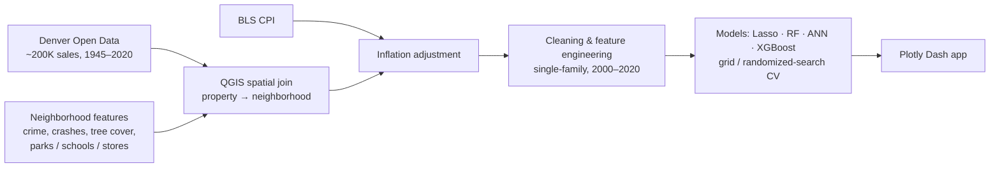

# Denver Housing Market Analytics

An end-to-end analytics project on Denver's single-family housing market. It integrates about 200K historical sales with neighborhood, socioeconomic, and inflation data, builds price-prediction models, and serves everything in an interactive Plotly Dash web app.

*Georgia Tech M.S. Analytics team project (2020).*

## Results

The tuned XGBoost model beat the Lasso baseline by **39% on RMSE** and the tuned Random Forest by **9%**. Metrics are on the held-out test set (`Notebooks/Part2_Model_Selection_Tuning.ipynb`).

| Model | RMSE | Median abs. error | R² |
|---|---|---|---|
| Lasso regression (baseline) | $72.7K | – | – |
| Neural network (60-30-60, Adamax) | $63.2K | $16.8K | 0.77 |
| Random Forest (tuned, 1,000 trees) | $48.5K | $14.5K | 0.86 |
| **XGBoost (tuned)** | **$44.1K** | **$13.3K** | **0.89** |

Top price drivers (Random Forest importance): above-grade living area, neighborhood per-capita income, average household income, sale year, and property age.

## Pipeline



- **Data integration:** the source datasets share no common keys. Each property was assigned to a neighborhood through spatial relationships in QGIS, and distances to the nearest food store, school, and park were computed for every property.
- **Features:** property attributes, neighborhood crime and traffic-accident counts, tree-cover percentage, demographic and socioeconomic indicators (Redfin, Denver Open Data), and CPI-adjusted prices (Bureau of Labor Statistics).

## Web app

The Plotly Dash app (`app.py`) has four tabs:

- **Denver House:** historical sale records on a map, with the model's predicted price for each property
- **Denver Neighborhood:** neighborhood features and median sale prices, for house-hunting reference
- **Denver City:** key housing-market metrics compared with similar cities
- **About:** project overview

The original Heroku deployment has been retired. To run the app locally:

```bash
pip install numpy pandas dash dash_core_components dash_html_components dash_bootstrap_components dash_table xgboost jsonschema
python app.py   # then open http://127.0.0.1:8050
```

Map layers and Street View thumbnails are optional. To enable them, put a Mapbox access token in `Credentials/mapbox_access_token.txt` and a Google Street View Static API key in `Credentials/google_street_view_api.txt`. Don't commit real keys.

## Repository layout

| Path | Contents |
|---|---|
| `Notebooks/` | `Part1_DataCleaning` → `Part2_Model_Selection_Tuning` → `Part3_DenverTimeSeriesAnalysis` |
| `Data/`, `CSVFiles/`, `JsonFiles/` | Raw and processed data, CSVs converted from shapefiles, GeoJSON for map layers |
| `Models/` | Trained XGBoost model and parameters, neighborhood-level price model |
| `app.py`, `utils.py`, `assets/` | Dash app, helper functions, CSS |

**Tech:** Python · pandas · GeoPandas · scikit-learn · XGBoost · Keras · QGIS · Plotly Dash · Mapbox · GeoJSON
