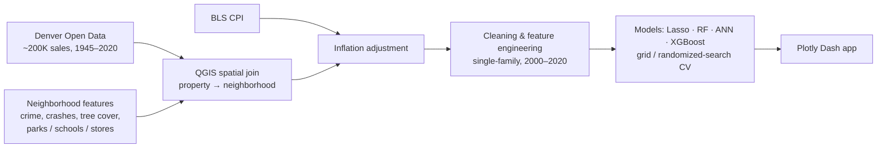
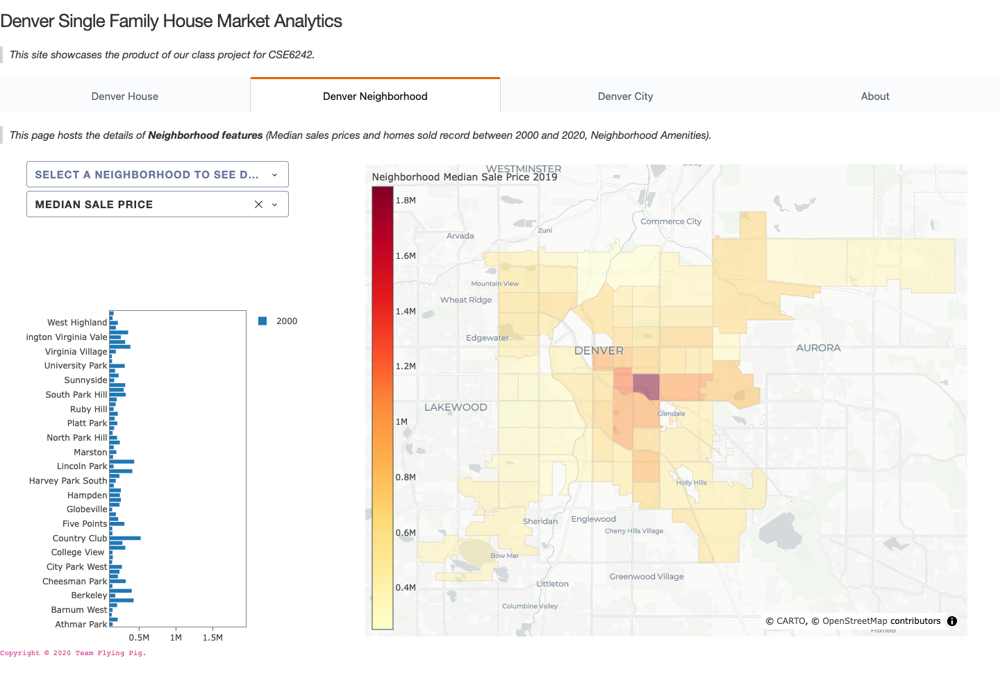

# Denver Housing Market Analytics

[](https://github.com/lzhao-byte/denver-housing/actions/workflows/ci.yml)

An end-to-end analytics project on Denver's single-family housing market. It integrates about 200K historical sales with neighborhood, socioeconomic, and inflation data, builds price-prediction models, and serves everything in an interactive Plotly Dash web app.

*Georgia Tech M.S. Analytics team project (2020).*

## Results

The tuned XGBoost model beat the Lasso baseline by **39% on RMSE** and the tuned Random Forest by **9%**. Metrics are on the held-out test set (`Notebooks/Part2_Model_Selection_Tuning.ipynb`).

| Model | RMSE | Median abs. error | R² |
|---|---|---|---|
| Lasso regression (baseline) | $72.7K | – | – |
| Neural network (60-30-60, Adamax) | $63.2K | $16.8K | 0.77 |
| Random Forest (tuned, 1,000 trees) | $48.5K | $14.5K | 0.86 |
| **XGBoost (tuned)** | **$44.1K** | **$13.3K** | **0.89** |

Top price drivers (Random Forest importance): above-grade living area, neighborhood per-capita income, average household income, sale year, and property age.

## Pipeline



- **Data integration:** the source datasets share no common keys. Each property was assigned to a neighborhood through spatial relationships in QGIS, and distances to the nearest food store, school, and park were computed for every property.
- **Features:** property attributes, neighborhood crime and traffic-accident counts, tree-cover percentage, demographic and socioeconomic indicators (Redfin, Denver Open Data), and CPI-adjusted prices (Bureau of Labor Statistics).

## Web app



The Plotly Dash app (`app.py`) has four tabs:

- **Denver House:** search historical sales on a parcel map, or get XGBoost price predictions for the house profiles you pick (neighborhood, bedrooms, bathrooms, age, size, distance to parks and stores), then filter and download the table
- **Denver Neighborhood:** neighborhood features and median sale prices, for house-hunting reference
- **Denver City:** key housing-market metrics compared with similar cities
- **About:** project overview

The original Heroku deployment has been retired. To run the app locally (needs [uv](https://docs.astral.sh/uv/)):

```bash
uv sync
uv run python app.py   # then open http://127.0.0.1:8050
```

Maps use a token-free CARTO basemap. Street View thumbnails for selected houses are optional: set `GOOGLE_STREET_VIEW_API_KEY` (see `.env.example`).

## Tests and maintenance

```bash
uv run pytest      # 37 tests, about 10 seconds
uv run ruff check .
```

CI runs both on every push, on Python 3.11–3.13 plus one job at the oldest supported versions (Dash 3.0, plotly 6.0, pandas 2.2, XGBoost 2.0).

In 2026 the app was brought up to date. Two of the fixes changed what users see:

- **Price predictions now use the inputs the model was trained on.** The saved model takes 40 features, but the app passed 33 by position. Seven were missing, the rest were shifted, and park/tree coverage were in the wrong units. The training column order was recovered from the model's split thresholds. With it, the shipped model reproduces the notebook's test-set results (RMSE $44.1K, R² 0.89). Inputs built the old way score R² 0.09 on the same test set. The model file now stores its feature names, so XGBoost rejects misordered input (`tests/test_model.py`).
- **Maps render again.** plotly.js 3 removed the Mapbox trace types, and the Stamen tiles were retired, so every map was blank. They now use MapLibre traces (`choroplethmap`, `scattermap`).

Also fixed: a blank "Max lot size" returned no sales, the prediction table's filter and CSV download failed on pandas 3, and packages were installed at import time. Details are in the commit history.

## Repository layout

| Path | Contents |
|---|---|
| `Notebooks/` | `Part1_DataCleaning` → `Part2_Model_Selection_Tuning` → `Part3_DenverTimeSeriesAnalysis` |
| `Data/`, `CSVFiles/`, `JsonFiles/` | Raw and processed data, CSVs converted from shapefiles, GeoJSON for map layers |
| `Models/` | Trained XGBoost model (`.ubj`, plus the original 2020 file), neighborhood-level price model |
| `app.py`, `utils.py`, `assets/` | Dash app, helper functions, CSS |
| `scripts/` | One-off model conversion; builds the per-neighborhood model inputs from the training data |
| `tests/` | pytest suite |

`Data/SingleFamilyHousesWithDetails_NeighborKey_TractKey.dbf`, the raw input to `Part1_DataCleaning`, was stored with Git LFS, and its content is no longer downloadable. Part 2, Part 3, the app, and the tests use the cleaned output (`Data/cleaned_house_records.csv`), which is in the repo.

**Tech:** Python · pandas · GeoPandas · scikit-learn · XGBoost · Keras · QGIS · Plotly Dash · MapLibre · GeoJSON · pytest · GitHub Actions
